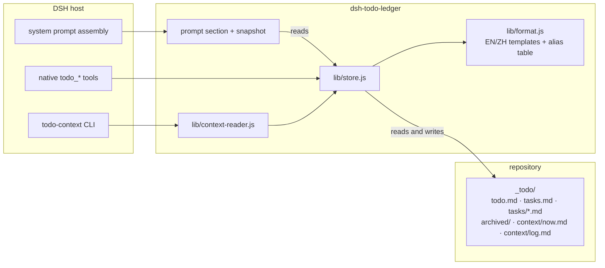
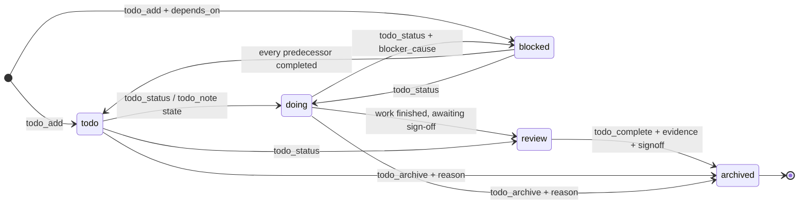
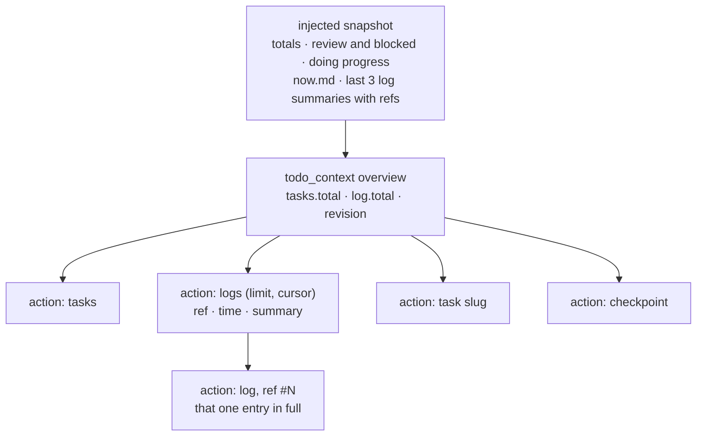
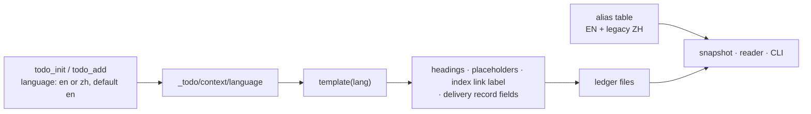
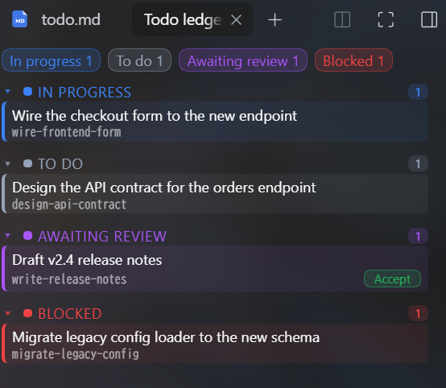
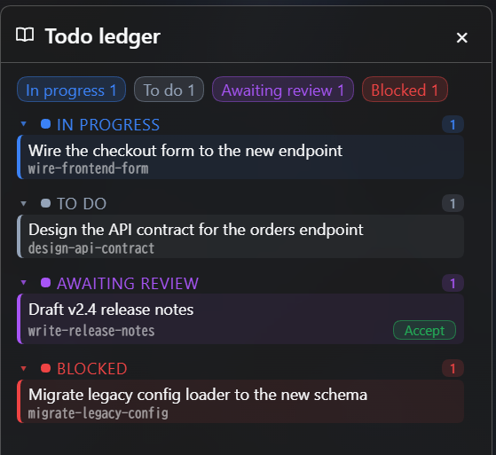
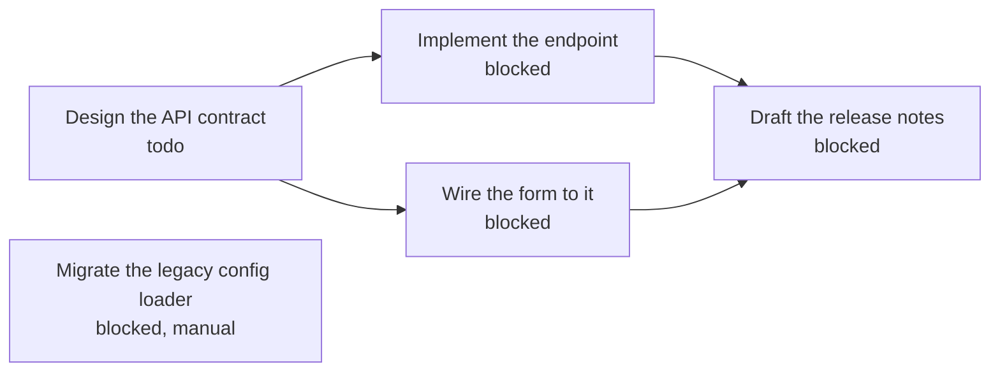

# dsh-todo-ledger


[](https://github.com/haruri03/dsh-todo-ledger/releases) [](https://www.npmjs.com/package/dsh-todo-ledger) [](LICENSE)

[English](README.md) | [中文](README_zh.md)

Repository: https://github.com/haruri03/dsh-todo-ledger

A host-level DSH plugin that turns the todo ledger workflow into a resident prompt section,
a set of native tools, and context stored inside the repository's `_todo/` directory.

It addresses the failure mode where rules live in a skill or `AGENTS.md`, the model forgets to
read them, and the task list has to be rewritten every turn:

| Before | This plugin |
|---|---|
| Rules live in `AGENTS.md` / a skill and stop working when the model does not read them | A host-level `systemPrompt.section` is present every step of every session, with no load step to forget |
| The system `todo_write` list is overwritten each turn and progress is lost | Authoritative state lives in the repository's `_todo/` files and survives sessions and compaction |
| Context exists only in conversation history and disappears after compaction | `todo_checkpoint` / `todo_note` write conclusions and next steps into `_todo/context/`, and a snapshot is injected on every prompt assembly |
| The model has to assemble shell commands itself | 12 native tools with schema validation and readable errors |

The file format is fully compatible with an external todo CLI: the plugin and the original CLI can
both write the same repository and both can run `doctor` on it.

The ledger scaffold follows the caller's choice: `todo_init` and `todo_add` accept an optional
`language` (`en` or `zh`), and the plugin writes the chosen form for the files of that ledger. It
defaults to English, so a caller outside a Chinese-speaking locale always gets an English ledger.
Both written forms are read, so a ledger written in either language — including one created by an
earlier version — keeps working, and content inside the sections is free-form.

## Register before implementation

When a ledger exists, the prompt instructs the agent to reuse a matching task or call `todo_add` for substantive new work requested by the user before editing deliverables, changing configuration, or running state-changing commands. Register the requested outcome, not each implementation step. Brief read-only scope inspection may come first; trivial Q&A and read-only checks need no task. Unclear scope calls for clarification, not an invented task. Historical checkpoints and inferred follow-ups do not authorize new work. Missing ledgers are initialized only when the user asks or confirms.

This is prompt guidance, not a runtime execution block or automatic task-creation mechanism.

## Install (manual)

Choose one:

**Human**: copy this directory to `$HOME/.dsh/profiles/<profile>/node_modules/dsh-todo-ledger`,
then append this row to the profile's `cordis.patch.yml`:

```yaml
- insert:
    - id: todo-ledger
      name: './lib/index.js'
```

**Agent**: run `plugin_manager install_bundle --target "<path-to-plugin>"`.

### Install from Git

When the repository root is the package (it contains `package.json` and `dsh.bundle`), install it
directly from its Git URL:

```powershell
plugin_manager install_bundle --target "git+https://github.com/haruri03/dsh-todo-ledger.git"
```

The same operation is available to humans through the Web plugin page ("Add plugin") or the CLI:

```powershell
dsh plugin --profile <profile> add "git+https://github.com/haruri03/dsh-todo-ledger.git"
```

### Install from npm

The package is published as `dsh-todo-ledger`, so the npm name alone installs it:

```powershell
plugin_manager install_bundle --target "dsh-todo-ledger"
```

```powershell
dsh plugin --profile <profile> add dsh-todo-ledger
```

Tarball URLs are accepted too. To update, remove and reinstall, or wait for an upstream release.

After installation, every new session carries a `[todo-ledger · cross-session tasks and context]`
prompt section, and the tool list gains:

`todo_context / todo_list / todo_add / todo_show / todo_status / todo_complete / todo_archive / todo_note / todo_checkpoint / todo_snapshot / todo_doctor / todo_init`

No restart is required.

## Layout

Inside the repository root (the directory that contains `_todo/`; a repository that already keeps `todo/` keeps working, the plugin accepts either name):

```
_todo/
├── todo.md              queue: `- [status] slug`
├── tasks.md             index: `- [status] **slug** — title → [details](tasks/slug.md)`
├── tasks/<slug>.md      details: goal / subtasks / acceptance / progress / blockers / files
├── archived/<slug>.md   completed + ## Delivery record (includes the sign-off quote)
├── AGENTS.md            directory notes generated by todo_init
└── context/             added by this plugin
    ├── now.md           current goal / next step / key files (overwritten by todo_checkpoint)
    └── log.md           append-only log (automatic tool trace + todo_note)
```

States are `todo` / `doing` / `blocked` / `review`; there is no `done`. `review` means work is
finished and waiting for the owner's sign-off. Closing a task requires both `evidence` and
`signoff` (the owner's own words); neither may be omitted. This is a hard rule of the todo ledger
workflow.

## How it works



The prompt section is assembled from the ledger, not stored in it: every prompt gets a fresh
snapshot, so a stale session cannot revive a stale task list.



There is no `done`. A predecessor in `review` does not unblock a dependent — only `todo_complete`
does.



The same four actions exist as `todo-context` subcommands. Nothing returns the whole log by
accident: the index is bounded, and a full entry needs its ref.



## Tools

| Tool | Purpose |
|---|---|
| `todo_list` | List tasks and states (optionally filtered); call it before starting work |
| `todo_show` | Show one task's details |
| `todo_add` | Create a task (unique kebab-case slug) |
| `todo_status` | Change state and sync the task frontmatter, index, and queue |
| `todo_complete` | Close and archive a task; requires `evidence` + `signoff` |
| `todo_archive` | Abandon a task; additionally requires `reason` |
| `todo_note` | Append to `context/log.md`; with `slug`, insert at the end of that task's `## Progress` section (the placeholder is removed on first write); with `state`, advance the state machine in the same call |
| `todo_checkpoint` | Overwrite `context/now.md`: current goal / next step / key files |
| `todo_snapshot` | Read-only: return the snapshot that would be injected into the prompt (check whether the ledger is stale) |
| `todo_context` | Bounded reads for progressive disclosure: `overview` first, then `logs` (summaries with stable refs and a cursor), `log` (one entry in full), `task`, or `checkpoint` |
| `todo_doctor` | Two-way consistency check; returns errors and warnings |
| `todo_init` | Create the `_todo/` skeleton (only when the user asks) |

Every tool accepts an optional `root`, so it can operate on repositories outside the workspace:

`todo_doctor { root: "<repo-root>" }`.

## Command line

The package installs a `todo-context` binary for scripts, editors, and agents that prefer a shell
over a tool call. It prints compact text by default; `--json` prints the same envelope the tool
returns.

```powershell
todo-context --action overview --root <repo-root>
todo-context --action logs --limit 5 --root <repo-root>
todo-context --action log --ref "#42" --root <repo-root>
todo-context --action task --slug <slug> --root <repo-root>
todo-context --action checkpoint --root <repo-root>
```

`--action` is one of `overview` / `tasks` / `task` / `checkpoint` / `logs` / `log`. Exit codes:
`0` success (a missing ledger also exits `0` and reports it), `1` inconsistent ledger or internal
error, `2` invalid arguments. `--root` defaults to the current directory, and a ledger in a parent
directory is found automatically.

The binary and the tool share one implementation, so both apply the same bounded-detail rules: no
command returns the whole log by accident.

## Sidebar panel



The plugin also serves a sidebar panel for the ledger of the current session working directory:
browsing is read-only, and the panel's only action is accepting a review task. It is opt-in: nothing is injected into the layout until a user opens the panel from the
right sidebar's guide capsule (named after the plugin); it then renders as a sidebar tab.

- Four sections — `doing`, `todo`, `review`, `blocked` — with a count each, plus a per-state colour
  so the shape of the ledger reads at a glance.
- Ordering is fixed: `doing` first, then `todo`, `review`, `blocked`; an empty section still shows.
- The panel reads; it does not write task content. Polling runs only while the panel is visible
  (every 5 s), so a closed or backgrounded tab costs nothing.
- When a session has no ledger above its working directory, or the ledger files disagree, the panel
  says so instead of guessing. Run `todo_doctor` to repair the latter.

Each row under `review` carries an **accept** action. Accepting a review task from the panel archives
it through the same path as `todo_complete`, recording the panel click as both the evidence and the
sign-off (`accepted from the ledger panel at <ISO timestamp>`). Only `review` tasks can be accepted
this way; any other state is refused with an inline error rather than an alarm.

### Floating panel

A book launcher below the composer opens a movable, resizable Todo Ledger floating panel. Drag
its header to move it and drag the bottom-right grip to resize it. It is an additional way to view
the ledger; the original right-sidebar panel remains available. The floating panel's labels follow
the host locale, and its body starts directly with the status counts because the window header
already names it. Every surface, border and state colour comes from the host theme tokens, so the
window follows the active theme — light, dark or a custom one — instead of carrying its own palette.



Each status group is collapsible: click a group header to fold it. Clicking a status count expands
that group and scrolls its header to the top of the list, which is how a long queue stays
navigable. Only the task list scrolls; the counts row and the footer stay put.

The panel is bound to the session it is shown in: switching to a session in another workspace
re-reads that workspace's ledger instead of keeping the previous one, and returning focus to the
window re-reads it again. The floating panel follows the session in front, so it re-targets when
the session changes instead of staying on the one that opened it.

The viewport-clamped box (position plus size) is saved in browser local storage and restored when
the panel opens again. Visibility and ledger content are not saved there: opening the panel reads
the current ledger rather than restoring a previous view.

The panel talks to two host routes, both read-only in intent and dispatched as `GET`:

| Route | Purpose |
|---|---|
| `/todo-ledger/projection?sessionId=<id>` | Ledger projection for that session's working directory |
| `/todo-ledger/complete?slug=<slug>&sessionId=<id>` | Accept one `review` task; the only side-effecting call |

A host restart is required after installing or updating the host-side code; the panel itself is plain
client JavaScript shipped by the package, so it needs no build step and appears after a page refresh.

## Dependencies

Tasks can wait for other tasks. Pass `depends_on` (a list of slugs) to `todo_add`, and the task is
created `blocked` with `blocker_cause: dependency` until every predecessor is **formally completed**.
If the predecessors are already completed, the task is created as `todo` straight away.



Completing `spec` promotes `impl` and `form` to `todo` in the same call. `notes` stays blocked until
both of its predecessors are completed — one is not enough. `legacy` has no predecessor: its
`blocker_cause: manual` means nothing unblocks it automatically.

- **Completion only.** A predecessor in `review` does not count; neither does an archived task that
  was dropped instead of completed. Only `todo_complete` — or the panel's accept — unblocks.
- **Validated at creation.** Unknown, already-dropped, self-referential and circular predecessors are
  rejected, as is a `dependency` blocker with no predecessor.
- **Repairable.** `todo_doctor` reports dependency fields that disagree with the archives.

## How context survives

1. On each system-prompt assembly the plugin finds the nearest `_todo/` above the session working
   directory and injects:
   - **Ledger last written: N ago** (the newest mtime among `context/log.md`, `tasks.md`, and `now.md`);
   - **Session staleness**: how many tool calls happened since the last `todo_*` write and how many
     of them were writes; 3 or more writes adds a ⚠ telling the agent to update the ledger first;
   - **Task totals** (four states), **review items** (with `(Nd)` days waiting) and **blocked** slugs;
   - **Progress of doing tasks**: the last real line of the task's `## Progress` section (≤80 chars);
     the whole line is omitted when there is no progress; a state unchanged for 2+ days is marked
     `state Nd unchanged`; template placeholders are filtered out;
   - The body of `context/now.md` and the last 6 log entries.
2. At every turn end (`agent/turn-stopping`) the plugin counts write-class operations per **turn
   boundary**. At 3 or more it appends a factual log entry (tool calls / writes / state changes)
   without inventing semantics. If the turn only wrote notes and never advanced a state, the entry
   says the state machine did not advance. It deliberately does **not** measure from the last
   `todo_*` write, because a final `todo_note` would reset the counter and hide a turn that edited
   many files but left a single note.
3. `todo_checkpoint` records conclusions, not long excerpts; `todo_note` records small findings;
   writes append a trace automatically.
4. After compaction, a new session, or a DSH restart, the next prompt still carries the snapshot,
   so work can continue.
5. Without a `_todo/` directory the plugin only injects the rules and mentions `todo_init`; it never
   creates the directory on its own.

> The unsolved half: the semantic summary is still written by the model. The plugin turns "the
> ledger is stale" into a visible fact and a ⚠ instead of inventing conclusions for the model.

## Configuration

This row in `cordis.patch.yml` can be adjusted:

```yaml
- id: todo-ledger
  name: './lib/index.js'
  config:
    root: "<repo-root>"                # optional: pin the repository root
    sectionOrder: 180                  # prompt section order, default 180
    maxSnapshotChars: 4000             # snapshot size limit, default 4000
```

Without `root`, the plugin searches upward from the session working directory for
`_todo/tasks.md`; if that fails it uses the `TODO_ROOT` environment variable.

## Verification

```powershell
node test/smoke.mjs
```

Coverage: prompt section registration and snapshot rendering, the schemas of all 12 tools, the full
init → add → status → note → checkpoint → doctor → complete/archive flow, and rejection of a close
without `signoff`. When `TODO_CLI` points at an external `todo.js`, the test also verifies
`list`/`doctor` interoperability.

## Uninstall

```powershell
plugin_manager remove_bundle --target dsh-todo-ledger
```

The plugin removes only its own registrations; the `_todo/` directory (including `context/`) is left
untouched.
