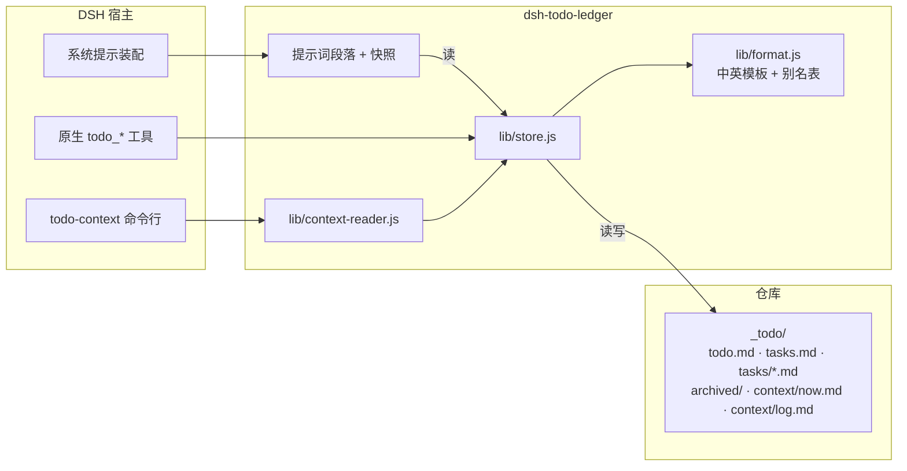
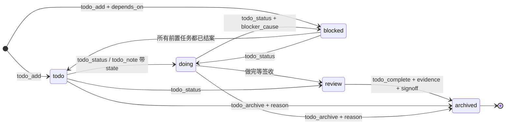
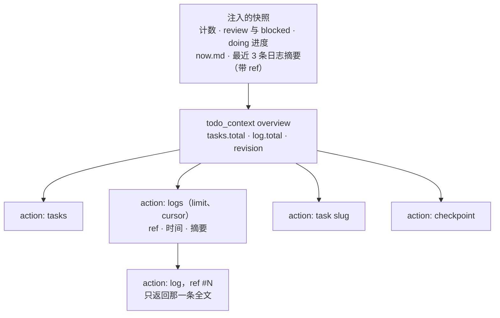
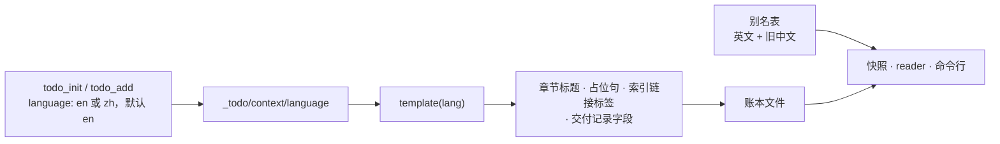
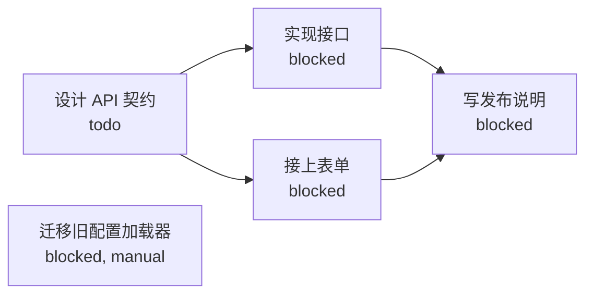

# dsh-todo-ledger

[](https://github.com/haruri03/dsh-todo-ledger/releases) [](https://www.npmjs.com/package/dsh-todo-ledger) [](LICENSE)

[English](README.md) | [中文](README_zh.md)

仓库：https://github.com/haruri03/dsh-todo-ledger

把 **todo 账本工作流**做成 DSH 宿主级插件：
**常驻提示段** + **原生工具** + **待办目录里的上下文留存**。

它解决的是「靠 skill / AGENTS.md 提醒，模型容易忘、要在每轮重写清单」的问题：

| 旧做法 | 这个插件 |
|---|---|
| 规则写在 AGENTS.md / skill 里，模型不读就失效 | 宿主级 `systemPrompt.section`，每个会话每步都在，不依赖模型记得加载 |
| 用系统 `todo_write` 每轮覆盖式重写，进度丢失 | 权威状态落在仓库 `_todo/` 文件里，跨会话、跨压缩都在 |
| 上下文只存在于对话历史，压缩后丢失 | `todo_checkpoint` / `todo_note` 把结论和下一步写进 `_todo/context/`，每次组装自动注入快照 |
| 模型要自己拼 shell 命令 | 12 个原生工具，schema 校验、错误可读 |

文件格式与外部 todo CLI **完全一致**，同一个仓库插件和原版 CLI 都能写、都能 `doctor`。

账本脚手架跟随调用方的选择：`todo_init` 与 `todo_add` 接受可选的 `language`（`en` 或 `zh`），插件按所选形式写入该账本的文件。默认英文，因此非中文环境的用户始终得到英文账本。两种书写形式都能读取，无论账本由哪种语言写成（包括更早版本创建的账本）都继续可用；各章节内的内容不受限制。

## 先登记，再实施

已有账本时，提示词要求 agent 对用户请求的实质性新工作，先复用匹配任务；没有匹配项则先调用 `todo_add`，再编辑交付文件、更改配置或运行改变项目状态的命令。登记的是用户要求的结果，不是每个实施步骤。允许先做简短的只读范围检查；简单问答和只读检查无需建任务。范围不明确时先澄清，不编造任务。历史检查点和推测的后续工作不构成新工作的授权。没有账本时，仅在用户要求或确认后初始化。

这是提示词引导，不是运行时执行拦截，也不会自动推断并创建任务。

## 安装（手动）

任选其一：

**人类**：把本目录复制到 `$HOME/.dsh/profiles/<profile>/node_modules/dsh-todo-ledger`，再在 profile 的 `cordis.patch.yml` 追加：

```yaml
- insert:
    - id: todo-ledger
      name: './lib/index.js'
```

**Agent**：让 agent 运行 `plugin_manager install_bundle --target "<path-to-plugin>"`。

### 从 Git 自动安装

仓库根就是包（含 `package.json` 与 `dsh.bundle`）时，可以直接用 Git 地址安装：

```powershell
plugin_manager install_bundle --target "git+https://github.com/haruri03/dsh-todo-ledger.git"
```

等价的人类操作：Web 插件页「添加插件」粘贴同一地址，或命令行：

```powershell
dsh plugin --profile <profile> add "git+https://github.com/haruri03/dsh-todo-ledger.git"
```

### 从 npm 安装

包已发布为 `dsh-todo-ledger`，直接写包名即可：

```powershell
plugin_manager install_bundle --target "dsh-todo-ledger"
```

```powershell
dsh plugin --profile <profile> add dsh-todo-ledger
```

也支持 tarball URL。更新时先卸载再安装，或等待上游发版。

装好后新会话的系统提示里会出现「【todo-ledger · 跨会话任务与上下文】」段；工具列表里多出
`todo_context / todo_list / todo_add / todo_show / todo_status / todo_complete / todo_archive / todo_note / todo_checkpoint / todo_snapshot / todo_doctor / todo_init`。
无需重启。

## 目录与文件格式

在仓库根（含 `_todo/` 的目录）下；已经用 `todo/` 的旧仓库继续可用，两个名字只认其一：

```
_todo/
├── todo.md              队列：`- [status] slug`
├── tasks.md             目录：`- [status] **slug** — 标题 → [详情](tasks/slug.md)`
├── tasks/<slug>.md      详情：目标 / 子项 / 验收 / 进度 / 阻塞 / 相关文件
├── archived/<slug>.md   结案 + ## 交付记录（含签收原话）
├── AGENTS.md            todo_init 生成的目录说明
└── context/             ← 本插件新增
    ├── now.md           当前目标 / 下一步 / 关键文件（todo_checkpoint 覆盖写）
    └── log.md           追加式流水（工具操作自动留痕 + todo_note）
```

状态只有 `todo` / `doing` / `blocked` / `review`；没有 `done`。`review` = 做完等负责人签收。
结案必须带 `evidence` 与 `signoff`（负责人原话），缺一不可——这是 todo 账本工作流的硬规则。

## 工作机制



提示词段落是从账本**现算**出来的，不是存在账本里：每次装配提示词都取一份新快照，陈旧的会话无法复活陈旧的任务列表。



没有 `done`。处于 `review` 的前置任务不算完成，不会解锁依赖它的任务——只有 `todo_complete` 算。



同样的四个动作在 `todo-context` 命令行里都有。任何命令都不会顺手把整份日志吐出来：索引是有界的，要正文得给 ref。



## 工具

| 工具 | 作用 |
|---|---|
| `todo_list` | 列出任务与状态（可按状态筛），开工先调 |
| `todo_show` | 看某任务详情 |
| `todo_add` | 新建任务（slug kebab-case，唯一） |
| `todo_status` | 改状态，同步详情 frontmatter / 索引 / 队列 |
| `todo_complete` | 结案归档，必须 `evidence` + `signoff` |
| `todo_archive` | 放弃归档，另需 `reason` |
| `todo_note` | 往 `context/log.md` 追加流水；带 `slug` 时**插入该任务「## 进度」节末尾**（首次写入清掉模板占位句）；带 `state` 时**顺手推进状态机**（治“只 note 不改状态”） |
| `todo_checkpoint` | 覆盖写 `context/now.md`：当前目标 / 下一步 / 关键文件 |
| `todo_snapshot` | 只读：返回当前会注入提示词的那份快照（用来确认账本是不是又旧了） |
| `todo_context` | 渐进式披露的按需读取：先 `overview`，再 `logs`（带稳定 ref 与游标的摘要）、`log`（单条全文）、`task` 或 `checkpoint` |
| `todo_doctor` | 双向一致性校验，返回 errors / warns |
| `todo_init` | 建 `_todo/` 骨架（只在用户要求时） |

所有工具都接受可选 `root`，方便对工作区之外的仓库操作，例如：
`todo_doctor { root: "<repo-root>" }`。

## 命令行

安装后会得到一个 `todo-context` 可执行入口，供脚本、编辑器或偏好命令行的 agent 使用。默认输出精简文本，`--json` 输出与工具一致的 envelope。

```powershell
todo-context --action overview --root <repo-root>
todo-context --action logs --limit 5 --root <repo-root>
todo-context --action log --ref "#42" --root <repo-root>
todo-context --action task --slug <slug> --root <repo-root>
todo-context --action checkpoint --root <repo-root>
```

`--action` 取值 `overview` / `tasks` / `task` / `checkpoint` / `logs` / `log`。退出码：`0` 成功（账本不存在也返回 `0` 并明确说明）、`1` 账本不一致或内部错误、`2` 参数非法。`--root` 缺省为当前目录，并会自动向上找到父目录里的账本。

命令与工具共用同一套实现，因此边界一致：任何一条命令都不会意外把整份日志吐出来。

## 侧栏面板


插件还会为当前会话工作目录的账本提供一个侧栏面板：浏览是只读的，面板上唯一的动作是「通过」一个待复核任务。
它是按需打开的：在右侧栏的引导胶囊（以插件名命名）点开之前，布局里不会多出任何东西；点开后作为一个侧栏标签页渲染。

- 四个分区 `doing` / `todo` / `review` / `blocked`，各带计数，并按状态配色，扫一眼就能看出账本形状。
- 顺序固定：`doing` 在最前，然后 `todo`、`review`、`blocked`；空分区保留占位而不是消失。
- 面板只读，不写任务内容。轮询只在面板可见时进行（每 5 秒一次），关掉或切到后台就不耗资源。
- 会话工作目录之上没有账本、或账本文件互相矛盾时，面板直接说明，不去猜。后者跑一次 `todo_doctor` 修。

`review` 分区里每条都带一个**通过**动作。从面板通过一个待复核任务，走的是与 `todo_complete` 相同的归档路径，
把这次点击同时记为验收证据和签收（`accepted from the ledger panel at <ISO 时间戳>`）。只有 `review` 态的任务
可以这样通过，其他状态会被拒绝并在面板内联报错，而不是抛异常。

### 浮动面板

输入框下方的书本入口可打开可移动、可缩放的 Todo Ledger 浮动面板：拖动标题栏移动窗口，拖动右下角
握把调整大小。这是查看账本的另一种方式，原有右侧栏面板仍可使用；浮动面板的文案跟随宿主语言，
面板正文直接从状态计数开始，因为窗口标题栏已经写了名称。所有背景、边框与状态颜色都取自宿主
主题 token，所以窗口会跟随当前主题（亮色、暗色或自定义主题），不自带一套配色。


浏览器本地存储保存浮动面板经视口边界限制后的窗口框（位置与尺寸），并在再次打开时恢复。
显示状态和账本内容不会保存在本地存储中：打开面板时读取当前账本，而不是恢复上次的内容。

每个状态分组可以折叠：点击分组标题即可收起。点击状态计数会展开该分组，并把它的标题滚到列表
顶部——长队列下这就是导航方式。只有任务列表滚动，计数行与页脚保持不动。

面板绑定到它所显示的那个会话：切到别的会话、哪怕换了工作区，也会重新读取那个工作区的账本，
而不是继续显示上一个；把焦点切回窗口时也会再读一次。悬浮窗跟着当前最前面的会话走，切会话
时它会一起换目标，而不是停在被打开时那个会话上。

面板对接两条宿主路由，都是 `GET` 派发：

| 路由 | 作用 |
|---|---|
| `/todo-ledger/projection?sessionId=<id>` | 返回该会话工作目录的账本投影 |
| `/todo-ledger/complete?slug=<slug>&sessionId=<id>` | 通过一个 `review` 任务；唯一有副作用的调用 |

安装或更新宿主侧代码后需要重启宿主；面板本身是包里自带的纯客户端 JavaScript，没有构建步骤，刷新页面即可出现。

## 依赖

任务可以等别的任务。给 `todo_add` 传 `depends_on`（slug 列表），这个任务就会以 `blocked` +
`blocker_cause: dependency` 建出来，直到所有前驱都被**正式完成**；如果前驱当时已经完成，它直接就是 `todo`。



完成 `spec` 会在同一次调用里把 `impl` 和 `form` 提升为 `todo`；`notes` 要等两个前驱都完成——只完成一个不够。
`legacy` 没有前驱，它的 `blocker_cause: manual` 意味着任何签收都不会自动解除它。

- **只认正式完成**：前驱处于 `review` 不算，被丢弃（dropped）的归档也不算；只有 `todo_complete`——或面板上的「通过」——才解锁。
- **创建时就校验**：未知、已被丢弃、自引用、成环的前驱都会被拒绝；`dependency` 却没有前驱同样被拒。
- **可修**：`todo_doctor` 会报出与归档不一致的依赖字段。

## 上下文是怎么留下来的

1. 每次组装系统提示时，插件读会话工作目录，向上找 `_todo/`，注入：
   - **账本最后写入：X 前**（`context/log.md` / `tasks.md` / `now.md` 的最大 mtime）；
   - **本会话记账陈旧度**：最近一次 `todo_*` 写入之后又发生多少次工具调用、其中多少是写入类；
     写入类 ≥3 时打 ⚠ 要求先补账；
   - **任务总计**（四态计数）+ **待签收 review**（带 `(Nd)` 挂了几天）+ **阻塞 blocked** 的 slug；
   - **doing 任务的进度**：取该任务「## 进度」节**最后一条**真实内容（≤80 字），
     没有进度就整行省略（不打印「（无进度）」这类空标记）；状态 ≥2 天没变会标「状态 Nd 未变」；
     模板占位句一律过滤。
   - `context/now.md` 正文与最近 6 条流水。
2. 每轮结束（`agent/turn-stopping`）按 **turn 边界**统计本轮写入类操作：≥3 次就自动往
   `context/log.md` 补一条事实流水（工具次数 / 写入类次数 / 状态推进次数），不编语义。
   本轮只有 note 没有状态推进时，会明确写「状态机没推进」。**刻意不以「最后一次 todo 写入」
   为起点**——否则收尾一条 `todo_note` 会把计数清零，掩盖「本轮猛改一堆文件、只留一句 note」。
3. `todo_checkpoint` 写结论（不是大段原文）；`todo_note` 记零碎发现；写操作自动追加流水。
4. 会话被压缩、换新会话、重启 DSH 之后，下一个回合的提示里仍然带着这份快照 → 接着干。
5. 没有 `_todo/` 时只注入规则并提示可以用 `todo_init`，不会擅自建目录。

> 还没解决的那一半：语义摘要仍要模型自己写。插件能做的是把「账本旧了」变成提示里的
> 事实和 ⚠，而不是替模型编造结论。

## 配置

`cordis.patch.yml` 里这一行可以改：

```yaml
- id: todo-ledger
  name: './lib/index.js'
  config:
    root: "<repo-root>"                # 可选：固定仓库根
    sectionOrder: 180                  # 提示段排序，默认 180
    maxSnapshotChars: 4000             # 快照上限，默认 4000
```

不填 `root` 时按「会话工作目录向上找 `_todo/tasks.md`」；再没有就用 `TODO_ROOT` 环境变量。

## 验证

```powershell
node test/smoke.mjs
```

覆盖：提示段注册与快照渲染、12 个工具 schema、init→add→status→note→checkpoint→doctor→complete/archive
全流程、缺 `signoff` 拒绝结案。设置 `TODO_CLI` 时额外验证与外部 `todo.js` 的 `list`/`doctor` 互通。

## 卸载

```powershell
plugin_manager remove_bundle --target dsh-todo-ledger
```

插件只删自己的注册；`_todo/` 目录（含 context/）不会被删。
